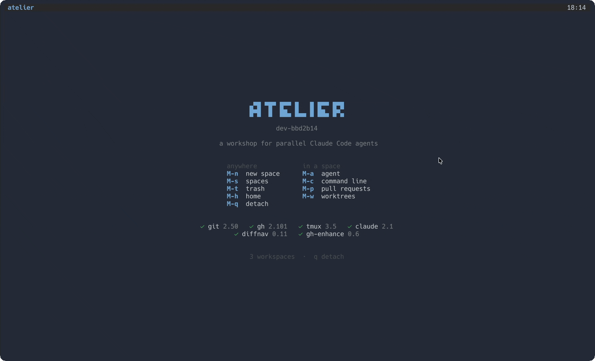

<div align="center">
<pre>
▄▀█ ▀█▀ █▀▀ █   █ █▀▀ █▀█
█▀█  █  ██▄ █▄▄ █ ██▄ █▀▄
</pre>

<h1>atelier</h1>

<p><strong>A workshop for parallel coding agents.</strong></p>

<p>
<a href="https://github.com/vyrwu/atelier/releases"></a>
<a href="https://github.com/vyrwu/atelier/actions/workflows/ci.yml"></a>
<a href="LICENSE"></a>
</p>

<p>
<a href="#install">Install</a> ·
<a href="#quick-start">Quick start</a> ·
<a href="#keys">Keys</a> ·
<a href="#configuration">Configuration</a> ·
<a href="#how-it-works">How it works</a> ·
<a href="#troubleshooting">Troubleshooting</a> ·
<a href="CONTRIBUTING.md">Contributing</a>
</p>
</div>

<p align="center">
  
</p>

atelier runs several coding agents side by side in your terminal, each on its
own task, and tells you which one needs you. Describe a task and it becomes a
**space**: a directory, a tmux session, and an agent already working. The pull
requests your agents open come to you, with their diff and CI one key away.

**Supported agents:** [Claude Code](https://claude.com/claude-code),
[Codex](https://developers.openai.com/codex), and
[Antigravity CLI](https://antigravity.google/docs/cli/reference/) (`agy`).
[Grok Build](https://docs.x.ai/build/overview) is coming soon.

## Highlights

- **Start in the background.** `M-n`, describe the task, keep working. A
  status-line spinner says when the space is ready.
- **One signal for attention.** A space waiting on you is marked in the status
  line and listed first.
- **Swap agents mid-task.** `M-x` hands a space from one agent to another, for
  when one runs out of quota. Swapping back resumes where it left off.
- **See every agent's usage.** The status line shows how much of each
  subscription's limits you've spent.
- **Review in the terminal.** Pull requests with CI, review, and merge-queue
  status, local diffs, and CI logs.
- **Worktrees that are never stale.** Agents branch from the freshly fetched
  default branch.
- **Retire and restore.** Clear a finished space; restoring resumes its
  conversation. Purge the ones you're done with by age.

## Install

| Requires | |
|---|---|
| [tmux](https://github.com/tmux/tmux) 3.3+, git | atelier runs its own tmux server |
| [GitHub CLI](https://cli.github.com) | run `gh auth login` first |
| Claude Code, Codex, or Antigravity CLI (`agy`) | at least the agent new spaces start with |
| A [Nerd Font](https://www.nerdfonts.com) 3.5.0+ | for the GitHub and agent icons |

Optional: [diffnav](https://github.com/dlvhdr/diffnav) or
[delta](https://github.com/dandavison/delta) for diffs,
[gh-enhance](https://github.com/dlvhdr/gh-enhance) for CI logs. macOS and Linux.

```sh
brew install --cask vyrwu/tap/atelier                 # macOS
go install github.com/vyrwu/atelier/cmd/atelier@latest
```

Or download a binary from [releases](https://github.com/vyrwu/atelier/releases),
or run `make install` from a clone. For releases built with the provenance
workflow, verify the downloaded archive before extracting it:

```sh
gh attestation verify <archive.tar.gz> --repo vyrwu/atelier \
  --signer-workflow vyrwu/atelier/.github/workflows/release.yml \
  --source-ref refs/tags/vX.Y.Z --deny-self-hosted-runners
```

Replace `vX.Y.Z` with the downloaded release's tag. Signed `.deb`, `.rpm` and
`.apk` packages are also built for amd64 and arm64, with a signed checksum
manifest and public keys. Follow the [verification and native installation
guide](docs/release-security.md#verify-and-install-downloads) before installing.
The [release security guide](docs/release-security.md) describes the build checks
and required setup. Public signing-key fingerprints are listed below.

## Quick start

```sh
atelier install   # once: agent hooks, tmux bindings, the per-space guide
atelier           # start, or re-attach
```

Press `M-n`, describe a task, and press `Enter` (`Tab` cycles agents).
`M-s` lists your spaces. `M-` means `Alt` (`Option` on a Mac).

Using Codex? Its first launch asks you to review new hooks: trust atelier's (the
ones running `atelier hook`). Until you do, Codex spaces show no status.

## Keys

The splash (`M-h`) lists them all.

| Anywhere | | In a space | |
|---|---|---|---|
| `M-n` | new space | `M-a` | the agent (restarts it if you exited) |
| `M-s` | spaces | `M-x` | swap agent |
| `M-t` | trash | `M-c` | command line |
| `M-h` | home | `M-p` | pull requests |
| `M-q` | detach | `M-w` | worktrees |

In the overlays, type to filter, `Up`/`Down` to move, `Esc` to close.

| View | Keys |
|---|---|
| Spaces | `Enter` open · `M-x` swap agent · `M-d` retire to Trash |
| Trash | `Enter` restore · `M-d` delete permanently |
| Pull requests | `Enter` diff · `M-e` checks · `M-b` browser · `M-o` reopen or ready · `M-c` close · `M-y` copy link |
| Worktrees | `Enter` shell in the worktree |
| New | `Enter` start · `Alt-Enter` start and switch · `Tab` next agent · `Ctrl-j` newline |
| Swap | `y` swap · `n` cancel · `Tab` cycle agents (including a fresh conversation with the same agent) |

In a PR's diff window, `M-e` opens its checks; in its checks window, `M-d` goes
back to the diff.

## Cleaning up

Spaces you retire wait in the Trash until you delete them. To clear out old
ones from a shell:

```sh
atelier ls --older-than 2w           # spaces untouched for two weeks, stalest first
atelier purge --older-than 30d       # delete Trash untouched for 30 days (asks first)
atelier purge --older-than 30d --all # active spaces too
atelier gc                           # sweep up what deleted spaces left behind
```

A space's age is from when it was last touched: made, swapped, retired, restored, or
last worked in by its agent. `purge` keeps any space whose worktrees hold
uncommitted changes or commits that aren't on a remote or in a pull request
(including unpublished commits in initialized submodules), unrecognized files outside verified
worktrees, or an incomplete directory scan. It also keeps running sessions:
retire those spaces first, or pass `--force` to stop them and discard unsaved work.
The enclosing space and the space containing the current directory are always
excluded. `--dry-run` shows what it would delete; `--yes` skips the question.

`gc` deletes no work. It drops records whose directory is gone, puts space
directories with no record in the Trash (or active Spaces if their session is
still running), recovers their agent from session metadata or conversations,
stops sessions still running for a space in the Trash, removes stale cache
files and Claude's entries for deleted
spaces, and prunes source repositories' records of deleted worktrees.
Swap lock files are retained so concurrent swaps keep sharing the same lock.
Cleanup stops on an unknown session-query result, and a failed session stop
keeps the workspace on disk.
`atelier gc --dry-run` reports without changing anything.

## Configuration

Optional, in `~/.config/atelier/config.toml`:

```toml
root         = "~/ateliers"  # where spaces live
socket       = "atelier"     # atelier's tmux socket
agent        = "claude"      # the agent new spaces start with: "claude", "codex", or "antigravity"
naming       = true          # let the agent title new spaces
naming_model = "sonnet"      # the model Claude titles them with
```

`ATELIER_ROOT` and `ATELIER_SOCKET` override `root` and `socket`. Every agent
reads one shared guide, `~/.config/atelier/WORKSPACE_CLAUDE.md`; edit it to
change what they're told.

## How it works

```
tmux -L atelier               atelier's own server; your tmux is untouched
├── home                      the splash: keymap and dependency check
└── spry-otter                one session per space
    ├── claude                the agent (Claude Code, Codex, or Antigravity)
    ├── shell                 M-c
    └── pr-atelier-128        a PR diff, opened from M-p
```

- **Status** comes from Claude/Codex hooks and Antigravity's native status-line
  events. They do nothing outside atelier.
- **Swapping** saves the outgoing agent's conversation to `.atelier/handoff/`
  in the space. The incoming agent starts at once with it, resuming its own
  earlier conversation there if it had one.
- **Usage** is each provider's own reading: Codex's every minute, Claude's
  after each turn or every 15 minutes, and Antigravity's quota snapshots while
  its CLI is running. `~` marks a reading that may be out of
  date; `—` means unknown.
- **Codex runs without its sandbox and approval prompts.** A worktree's git
  data lives in its source repository, outside the space, so the sandbox
  would block every commit.

Install and sign in to `agy` using [Google's CLI setup](https://antigravity.google/docs/cli/reference/),
then choose Antigravity with `Tab` or set `agent = "antigravity"`. Atelier uses
its native model, effort, and permission settings; select Gemini with `/model`
and adjust reasoning with `/effort`. The integration targets CLI 1.5.3.

Antigravity receives workspace-local MCP registration and an `AGENTS.md` guide.
A session-only settings overlay captures its native status, conversation path,
and quota without changing global settings; an existing status-line command
keeps its output. Conversation pointers in `.atelier/antigravity/` let restore
and swaps find the native transcript. Keep that directory when moving a space.
Quota is unknown until the CLI reports a remaining fraction and reset time;
absolute credits and token counts are not converted into percentages. Antigravity
spaces use a title derived from the task text, without a separate model call.

The reasoning behind all of it is in [DESIGN.md](DESIGN.md).

## Troubleshooting

- **`M-` keys do nothing.** Make your terminal send `Option` as Meta: iTerm2
  *Left Option key: Esc+*, Terminal.app *Use Option as Meta key*, Ghostty
  `macos-option-as-alt = true`, kitty `macos_option_as_alt yes`, Alacritty
  `option_as_alt = "Both"`. WezTerm works by default.
- **Icons show as boxes.** Use a Nerd Font, 3.5.0 or newer for the agent icons.
- **Colours look flat.** Start atelier from a terminal with
  `COLORTERM=truecolor`.
- **A key doesn't match this README.** Open any overlay once after upgrading,
  or run `atelier install`.
- **A PR doesn't appear.** Check `gh auth status`. A PR shows up when its branch
  is a worktree in the space, or the agent registered it.
- **A space shows the wrong agent after an upgrade.** Restart its agent once
  (exit it, then `M-a`).

## Roadmap

- **Grok Build**, as another agent.
- **Remote spaces**: run a space's agent on another host.
  ([#104](https://github.com/vyrwu/atelier/issues/104))
- **Embedded CLI**: describe a command in a shell, get it ready to run.
  ([#103](https://github.com/vyrwu/atelier/issues/103))

## Development

```sh
make dev        # an isolated instance under ~/.atelier-dev, own tmux socket
make test
golangci-lint run ./...
```

Releases come from [Conventional Commits](https://www.conventionalcommits.org)
via release-please. Read [CONTRIBUTING.md](CONTRIBUTING.md) before opening a
pull request.

## License

[MIT](LICENSE) © vyrwu

## Release signing keys

These fingerprints identify the public keys distributed with signed releases.
Compare them before trusting a downloaded key. Private keys are stored only in
the protected `release` environment; key rotation updates this table.

| Key | Signs | Fingerprint |
| --- | --- | --- |
| `atelier.asc` | `.rpm`, `.deb`, `checksums.txt` | `70A2553E9D05AAE5EE4AE0FD8946100349BDF034` |
| `atelier.rsa.pub` | `.apk` | SHA-256 `924b2c7196f8aa9f5ec08711691215a9e829eb4d377c0f538506e5f8f9d8c128` |
